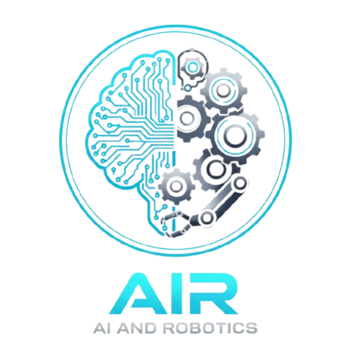

# AI and Robotics  
**Course ID:** 02360770  

---

## Instructor
**Dr. Sarah Keren**
## TA
Guy Azran

---

## Course Overview
This course focuses on designing and modeling single-robot and multi-robot systems using tools from artificial intelligence, such as automated planning, sequential decision-making under uncertainty, game theory, multi-agent systems, and reinforcement learning.

We cover three main units:
- Single robot (sensing, planning, control, and navigation)
- Long-term and complex tasks (Integrated Task and Motion Planning)
- Multi-robot settings

The course combines theoretical foundations with practical work with robots in both simulated and real settings.

## Reading List

### Core Textbooks
- Probabilistic Robotics – Sebastian Thrun, Wolfram Burgard & Dieter Fox  
- Artificial Intelligence: A Modern Approach – Stuart Russell & Peter Norvig  
- Reinforcement Learning: An Introduction – Richard Sutton & Andrew Barto  

### Additional References
- Multiagent Systems: Algorithmic, Game-Theoretic, and Logical Foundations – Yoav Shoham & Kevin Leyton-Brown  
- An Introduction to MultiAgent Systems – Michael Wooldridge  
- Rules of Encounter: Designing Conventions for Automated Negotiation – Jeffrey S. Rosenschein & Gilad Zlotkin  
